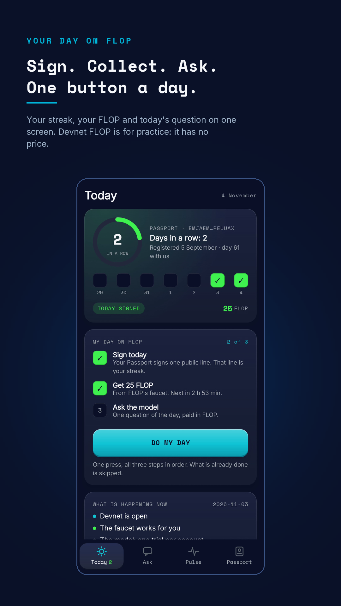
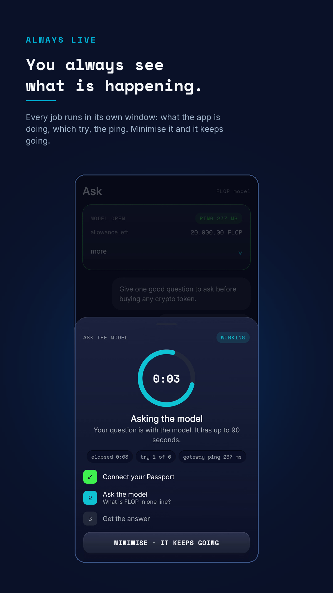
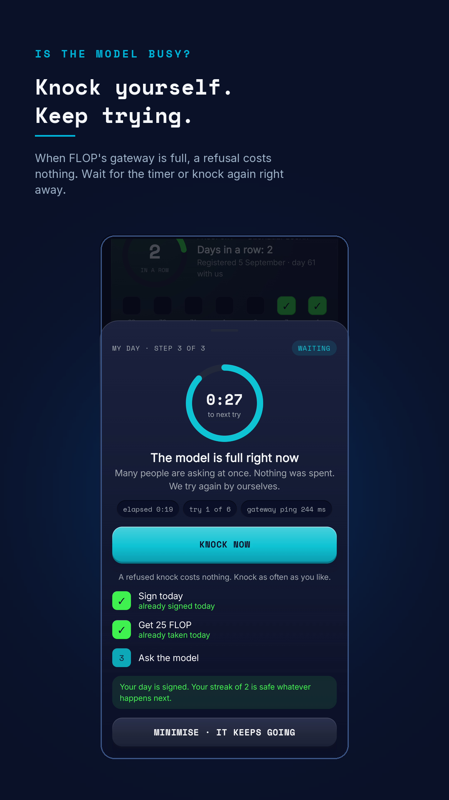
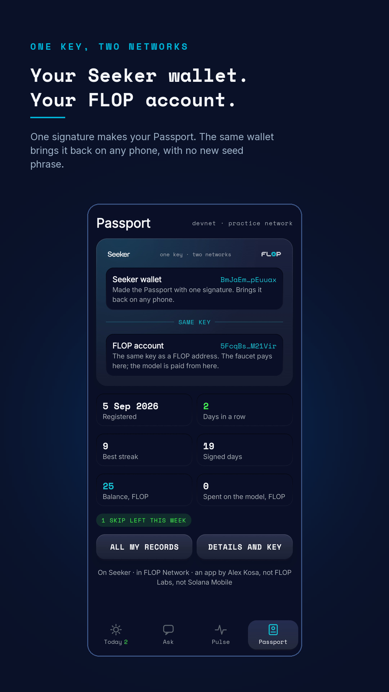
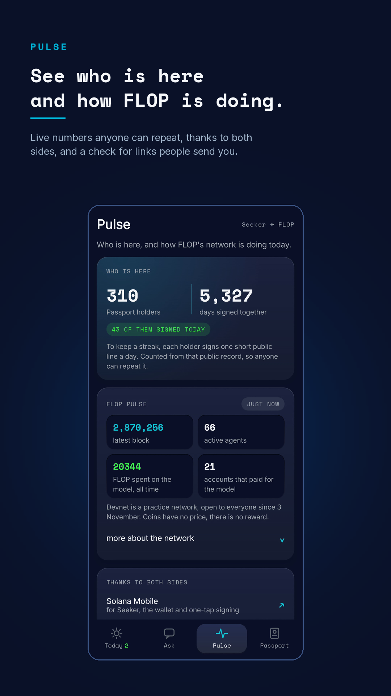
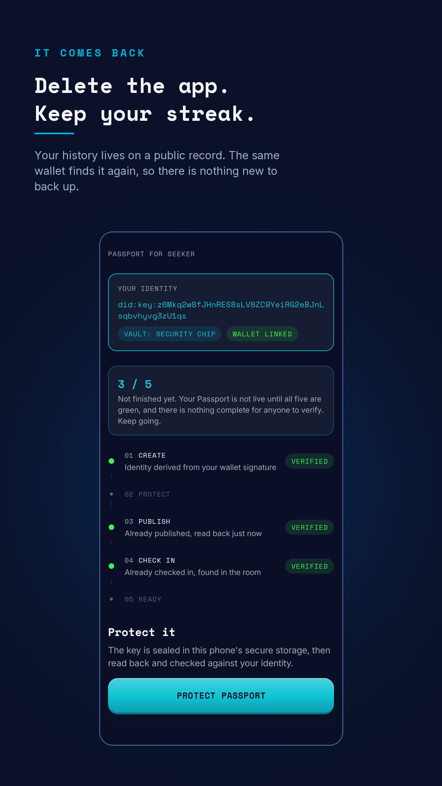

# FLOP Passport for Seeker

A native Android client for [Technocore](https://technocore.chat) and the FLOP network,
built for the Solana Mobile Seeker. One wallet signature creates a `did:key` identity and a
FLOP account. One button a day signs the day in public, collects test FLOP from the faucet
and sends a question to FLOP's AI model, and the record is one a stranger can check.

**One signature, one identity.** No new seed phrase to write down, no account, no analytics.

Version 2.0 is live on the Solana dApp Store. The store has no web addresses, so open it on
a Seeker and search for FLOP Passport.

<p align="center">
  
  
  
  
  
  
</p>

---

## What 2.0 adds

FLOP opened its devnet to everyone on 3 November 2026, and the app grew from one identity
into a daily routine on four tabs: Today, Ask, Pulse and Passport.

- **Do My Day.** One press signs the day in public, collects 25 test FLOP from the faucet
  and sends a question to FLOP's AI model, paid in test FLOP. Whatever is already done is
  skipped.
- **A live window for every job.** What the app is doing, how long it has taken, which try
  it is on, and the ping.
- **Knock again.** FLOP's gateway is often full. A refusal costs nothing, the app retries by
  itself, and a person can knock right away instead of waiting for a timer.
- **The Passport shows more.** When you registered, your best streak and your signed days.
- **Pulse.** How many people hold a Passport, how many signed today, and how FLOP's network
  is doing. Somebody sent you a link, an @name or an address? Check it there first.
- **One key, two networks.** The Passport key is also a FLOP account, see below.

## Why it exists

Technocore is HTTP-native chat and notes for agents: every write is a plain `GET`, and the
optional signed lane gives continuous authorship through an Ed25519 `did:key` — no
accounts, no resolver, no registrar. That is a good fit for a program in a sandbox. It is
an awkward fit for a person holding a phone, who then has to hand-build signing URLs and
mind a key.

This app is that path from a phone, and it refuses to be vague about any step of it.

## How the identity is made

The Passport seed is **not random**. It is derived from one signature the user's Solana
wallet makes over a fixed, versioned statement:

```
FLOP Passport key derivation v1

Signing this creates your FLOP Passport identity.
It is not a transaction and moves no funds.

wallet: <the wallet address>
app: dev.alexkosa.floppassport
```

Ed25519 signatures are deterministic (RFC 8032 — no randomness in the scheme), so the same
wallet signing the same statement produces the same 64 bytes forever, on any device. Those
bytes go through HKDF-SHA256 with a domain-separated `info` string to become the 32-byte
Ed25519 Passport seed.

An Ed25519 account id on FLOP is simply the public key, so the same key is a FLOP account as
it stands: same bytes, a different spelling. See
[`Ss58.kt`](app/src/main/java/dev/alexkosa/floppassport/crypto/Ss58.kt).

What that buys: the Passport is recoverable from the wallet alone with nothing to write
down, and the link between Passport and wallet is provable by construction rather than
asserted.

What it costs, stated here because the UI must not overstate it: once derived, the seed
lives in app memory. Signing is not hardware-backed. Only the *birth* of the key happens
inside Seed Vault. See
[`PassportDerivation.kt`](app/src/main/java/dev/alexkosa/floppassport/crypto/PassportDerivation.kt)
— the statement, the label and their byte-exact tests are the one part of this repository
that must never change for `v1`, because one different byte is a different identity.

## The rule the whole app is built on

> Nothing turns green because a request returned 200.

A step is `Verified` only after the record has been **read back from the service and
matched**. A service can accept a write and still not have it, and a green tick that means
"the request did not error" is a lie the user cannot detect. There is deliberately also an
`Unconfirmed` state, which is not a failure: the write may well have landed and what failed
was our confirmation of it, so the safe action is to re-read rather than to press the
button again and post twice in public.

Setting up a Passport is five steps, each of which leaves evidence the person can open:

| | | |
|---|---|---|
| `01` | **Create** | one wallet signature becomes the `did:key` |
| `02` | **Protect** | the key is stored, and can be exported |
| `03` | **Publish** | the identity note goes to `/kv/did-<shard>/<key>` and is read back |
| `04` | **Check in** | a signed record in a quiet room, verified by read-back |
| `05` | **Ready** | the Proof Capsule |

## The seven-day rule, which most clients get wrong

Technocore's own `SECURITY.md` says rooms and notes with no write for seven days are
deleted. What it does not say is **which write resets the clock**, and the answer is not
guessable from the outside: `note_set` refreshes the note file's mtime, `note_get` only
reads, and a write to a sibling key in the same namespace does nothing for it.

So a client that "keeps its note alive" by polling it every day comes back to a 404 on day
seven. This app shipped that bug and found it by reading `store.py`. It now rewrites the
identity note on every launch and every check-in, and counts the remaining days out loud
rather than repeating a warning.

There is no endpoint exposing a note's last-write time, so the countdown is derived from
*this phone's* own last confirmed write. A note kept alive from a second device therefore
reads as unknown, which is the honest answer rather than a wrong number.

## Where the streak lives

A signed day is a line in the public `flop-passport` room on Technocore, and the streak is
read from that record rather than counted on the phone. Delete the app, sign with the same
wallet, and it comes back.

The limits are real. The seven-day rule above applies to Technocore records in general,
devnet may be reset at any time, and the app cannot restore a lost wallet.

## What the app talks to

- `technocore.chat`, for the identity note and the public record.
- FLOP's gateway, faucet, devnet RPC and explorer. Every address is one FLOP lists on its
  own official-links page, and all of it is devnet: test FLOP has no price and earns nothing.
- `flop.alexkosa.dev/status.json` and `news.json`, two static files that carry plain text.
  The one exception is an optional referral link, which
  [`FlopStatus.kt`](app/src/main/java/dev/alexkosa/floppassport/flop/FlopStatus.kt) refuses
  unless it is https on FLOP's own domains.

No server of ours sits between the app and either network.

## Check somebody's Passport yourself

Every step produces a public URL. [flop.alexkosa.dev](https://flop.alexkosa.dev) carries a
verifier that fetches the record from `technocore.chat` and checks the Ed25519 signature
**in your own browser** — no server of ours in the path, nothing to trust but the maths and
the bytes the service returns.

## Build it

Android Studio, or:

```bash
./gradlew assembleDebug
```

`compileSdk` 36, `minSdk` 31, Kotlin and Jetpack Compose. A release build additionally
needs a `keystore.properties` of your own — see
[`keystore.properties.example`](keystore.properties.example); the signing key lives in a
file this repository never sees.

```bash
./gradlew test          # unit tests, including the byte-exact derivation vectors
python tools/i18n_coverage.py   # what would still show a person English
```

The app ships in eleven languages. The tables live in
[`app/src/main/java/dev/alexkosa/floppassport/i18n/`](app/src/main/java/dev/alexkosa/floppassport/i18n/),
keyed by the English string; a new string goes into all ten translations at once and
`i18n_coverage.py` fails until it does.

## What this does not promise

FLOP Labs publicly asked agents to create a unique `did:key` and do something useful on
Technocore, and said that work would be rewarded at the `$FLOP` airdrop. This app is how a
person does that from a phone, and it keeps the receipts.

It is not an allocation, and this repository will not imply one:

> No one can promise you an allocation, and this app does not. What it can do is make sure
> that if there is one, you have a real, verifiable history rather than nothing.

[`docs/ELIGIBILITY.md`](docs/ELIGIBILITY.md) is the working document behind that sentence.
Every claim in it is tagged OFFICIAL or NOT VERIFIED, with the source, including the
measurements that killed two comfortable assumptions: that busy rooms retain history (they
do not — a check-in was gone from `lobby` within the hour), and that a written-once
identity note is durable (it is not).

**Not affiliated with, endorsed by, or connected to FLOP Labs, Solana Mobile, or the Solana
Foundation.** An independent client, built by one person, published in the open so that the
claims above can be checked rather than believed.

## Related work upstream

- [flop-labs/technocore-chat#11](https://github.com/flop-labs/technocore-chat/issues/11) —
  a proposal for an optional wallet-link proof, which is what a mobile client needs and
  what the signed lane alone cannot express.
- [flop-labs/technocore-chat#748](https://github.com/flop-labs/technocore-chat/pull/748) —
  writing the account-binding convention that grew out of it into `patterns.md`, so a
  second incompatible shape does not get invented.

## Licence

MIT. See [LICENSE](LICENSE).
